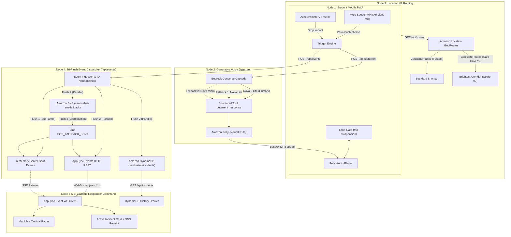

# Sentinel AI — Architectural Nodes, Flush Lifecycle & Machine Execution Pipeline

This document provides a technical walkthrough of **Sentinel AI**, detailing every execution node, flush cycle, data synchronization boundary, and the exact operations the system performs at each stage.

---

## 1. Executive Pipeline Architecture



---

## 2. Deep Dive: Each Execution Node & "Flush" Lifecycle

### Node 1: Mobile Edge Sensor & Audio Capture
- **Location**: `src/components/mobile/MobileShell.tsx` & `StealthListener.tsx`
- **What the machine does**:
  1. **Continuous Speech Recognition**: Runs `webkitSpeechRecognition` with continuous listening and intermediate result processing.
  2. **Zero-Touch Keyword Matching**: Evaluates speech against the cover phrase (`"blue keys on the table"`). When detected, it transitions the mobile UI to an active phone call without the user touching the screen.
  3. **Threat Keyword Monitor**: During an active call, checks ambient speech against threat keywords (`"help"`, `"back off"`, `"stop"`, `"get away"`).
  4. **Accelerometer Drop Detection**: Subscribes to `devicemotion`. If acceleration magnitude drops (`freefall < 3 m/s²`) followed by an abrupt spike (`impact > 25 m/s²`), triggers a critical alert.
  5. **Echo-Gating**: When audio is playing from Maya (the AI friend), the system **suspends speech recognition** to prevent self-echo and hallucination loops, resuming 500ms after playback completes.

---

### Node 2: Generative Voice Deterrent (Bedrock + Polly)
- **Location**: `src/app/api/deterrent/route.ts` & `src/lib/aws/deterrentVoiceAdapter.ts`
- **What the machine does**:
  1. **Context Sanitization**: Enforces strict alternating `user`/`assistant` message order and caps conversation history to the last 8 turns.
  2. **Multi-Model Bedrock Cascade**:
     - Sends `ConverseCommand` to **Amazon Nova 2 Lite** (`us.amazon.nova-2-lite-v1:0`).
     - If throttling, region unavailability, or verification delays occur, seamlessly cascades to **Nova Lite** (`us.amazon.nova-lite-v1:0`), then **Nova Micro** (`us.amazon.nova-micro-v1:0`).
  3. **Forced Tool Calling**: Enforces the `deterrent_response` tool schema, extracting structured JSON containing `threatDetected`, `threatLevel`, `detectedCue`, and `spokenReply` (concise 1–2 spoken sentences).
  4. **Neural Speech Synthesis**: Calls `PollyClient.send(new SynthesizeSpeechCommand(...))` using the **Ruth** Neural engine (`VoiceId: Ruth`, `Engine: neural`, `OutputFormat: mp3`).
  5. **Base64 Payload Stream**: Converts the binary audio stream to Base64 and returns it in the HTTP JSON response for instant client playback.

---

### Node 3: Pedestrian Corridors & Dynamic Lighting Routing
- **Location**: `src/app/api/routes/route.ts` & `src/lib/aws/locationAdapter.ts`
- **What the machine does**:
  1. **Parallel Route Computation**:
     - Dispatches two parallel `CalculateRoutesCommand` calls via `@aws-sdk/client-geo-routes` with `TravelMode: 'Pedestrian'`.
     - **Fastest Route**: Direct line-of-sight path from Student Origin to Destination.
     - **Brightest Route**: Injects intermediate pedestrian waypoints steering through verified campus Safe Havens (24/7 Campus Pharmacy, NightOwl Cafe, North Gate Booth).
  2. **Polyline Decoding & LineString Stitching**: Decodes compressed polylines into GeoJSON `[longitude, latitude]` coordinates.
  3. **Proximity & Safety Scoring**: Computes Haversine distances to Safe Havens. Paths staying within 150m of verified safe points receive a safety score of 95–100.
  4. **MapLibre V2 Vector Basemap**: Delivers high-contrast dark vector tiles using Amazon Location Service V2 descriptor URL:
     `https://maps.geo.us-east-1.amazonaws.com/v2/styles/Standard/descriptor?key={apiKey}&color-scheme=Dark`

---

### Node 4: The Tri-Flush Event Dispatcher (`POST /api/events`)
- **Location**: `src/app/api/events/route.ts`
- **What the machine does**:
  When an incident or threat escalation occurs, this endpoint executes a **3-stage flush**:

#### Flush Stage 1: Sub-10ms In-Memory SSE Flush
- Synchronously pushes the event into `globalThis.sentinelEventBus`.
- Any open browser tab or iframe connected to `/api/events` receives the telemetry instantly with zero cloud latency.

#### Flush Stage 2: Concurrent Multi-Cloud Flush (`Promise.allSettled`)
- **Flush 2A — AWS AppSync Events**: Posts to the REST endpoint `https://<http-domain>/event` on channel `/sentinel/live` with API Key auth.
- **Flush 2B — Amazon DynamoDB Ledger**: Calls `dynamoStore.mergeAndUpsertIncident()`.
  - Keys: `pk: "INCIDENT"`, `sk: "INC#<incidentId>"`.
  - Performs atomic merge: retains existing creation timestamps and coordinates while updating status (`ACTIVE`, `DISPATCHED`, `RESOLVED`), threat levels, and transcripts.
- **Flush 2C — Amazon SNS Emergency Beacon**:
  - If event is `THREAT_ESCALATED` or `PHONE_DROP_DETECTED`, formats an SMS-compliant string (<320 chars):
    ```text
    🚨 SENTINEL SOS BEACON
    INCIDENT: inc_abc123
    ALERT: [CRITICAL] AI_AUDIO_ESCALATION @ Campus Corridor
    GPS: https://maps.google.com/?q=37.87100,-122.25890
    NOTE: Threat detected by Bedrock Nova 2
    ```
  - Dispatches to topic `arn:aws:sns:us-east-1:888382026874:sentinel-ai-sos-fallback`.

#### Flush Stage 3: Confirmation Flush (`SOS_FALLBACK_SENT`)
- Once Amazon SNS returns an AWS MessageId (e.g., `ff8c3fd9-...`), the server:
  1. Creates an `SOS_FALLBACK_SENT` event.
  2. Broadcasts it across SSE and AppSync Events.
  3. Updates the DynamoDB incident record with `snsMessageId`.

---

### Node 5: Real-Time Mesh WebSocket Adapter
- **Location**: `src/lib/aws/realtimeMeshAdapter.ts`
- **What the machine does**:
  1. **WebSocket Handshake**: Connects to `wss://<realtime-domain>/event/realtime` with subprotocols `['aws-appsync-event-ws', 'header-<base64url>']`.
  2. **Protocol Lifecycle**:
     - Sends `{"type": "connection_init"}`.
     - Receives `connection_ack`, reads `connectionTimeoutMs`, starts keep-alive watchdog.
     - Subscribes to `/sentinel/live`.
  3. **Watchdog & Self-Healing**: Resets timer on every `ka` (keep-alive) ping. If 300s elapse without a ping, closes socket and triggers exponential backoff reconnect (3s → 6s → 15s → 30s).
  4. **Deduplication Engine**: Maintains a bounded Set (`seenEventIds`, max 100 entries) so events arriving from both AppSync and SSE failover are never processed twice.
  5. **Graceful Failover**: If AppSync cannot connect within 5 seconds, falls back to `/api/events` SSE (`LOCAL SSE FALLBACK`).

---

### Node 6: Campus Command Center (Dashboard)
- **Location**: `src/components/dashboard/DashboardShell.tsx`, `IncidentFeed.tsx`, `ResponderMap.tsx`
- **What the machine does**:
  1. **Hydration on Mount**: Calls `GET /api/incidents` to load Safe Havens, Responders, and past incidents from DynamoDB.
  2. **Tactical Radar**: Draws a 500m dynamic incident radius circle around the victim's live coordinates.
  3. **Acoustic Buffer Simulation**: Visualizes a 10-second rolling pre-trigger ambient audio buffer with playback audio synthesizer.
  4. **Two-Way Dispatch**: Clicking "Dispatch Unit" assigns a responder, calculates ETA, publishes `RESPONDER_DISPATCHED` over the mesh, and notifies the victim's phone immediately.

---

### Node 7: AWS Amplify SSR Hosting (`WEB_COMPUTE`)
- **Location**: `amplify.yml`, `scripts/deploy-amplify.mjs`
- **What the machine does**:
  1. **Webpack Production Bundling**: Uses `next build --webpack` to avoid Turbopack NTFS symlink conflicts inside Amplify's build container.
  2. **Safe Environment Generation**: Builds `.env.production` during the preBuild phase using Node regex extraction, strictly omitting `AWS_PROFILE` and developer credentials.
  3. **Compute Role Execution**: Runs on AWS Amplify `WEB_COMPUTE` using `sentinel-ai-amplify-compute-role`, allowing the Lambda SSR container to call Bedrock, Polly, Location, DynamoDB, and SNS using AWS IAM temporary instance credentials.

---

## 3. Active Local Endpoints

| Service / Port | URL | Status | Description |
| :--- | :--- | :--- | :--- |
| **Next.js Server** | `http://localhost:8000` | **ACTIVE** | Full Stage Shell (Split Screen, Mobile PWA, Dashboard) |
| **Mobile PWA** | `http://localhost:8000/mobile` | **ACTIVE** | Student UI with Voice & Gesture Triggers |
| **Command Center** | `http://localhost:8000/dashboard` | **ACTIVE** | Security Radar & Incident Audit Ledger |
| **Routes API** | `http://localhost:8000/api/routes` | **ACTIVE** | Parallel Amazon Location Service GeoRoutes |
| **Incidents API** | `http://localhost:8000/api/incidents` | **ACTIVE** | Live DynamoDB Hydration & Persistence |
| **Deterrent Voice API** | `http://localhost:8000/api/deterrent` | **ACTIVE** | Bedrock Nova Cascade + Polly Neural Ruth |
| **Events Mesh API** | `http://localhost:8000/api/events` | **ACTIVE** | Real-Time Tri-Flush Dispatcher |
| **SNS Fallback API** | `http://localhost:8000/api/sos-fallback` | **ACTIVE** | Emergency SMS Beacon Dispatcher |
